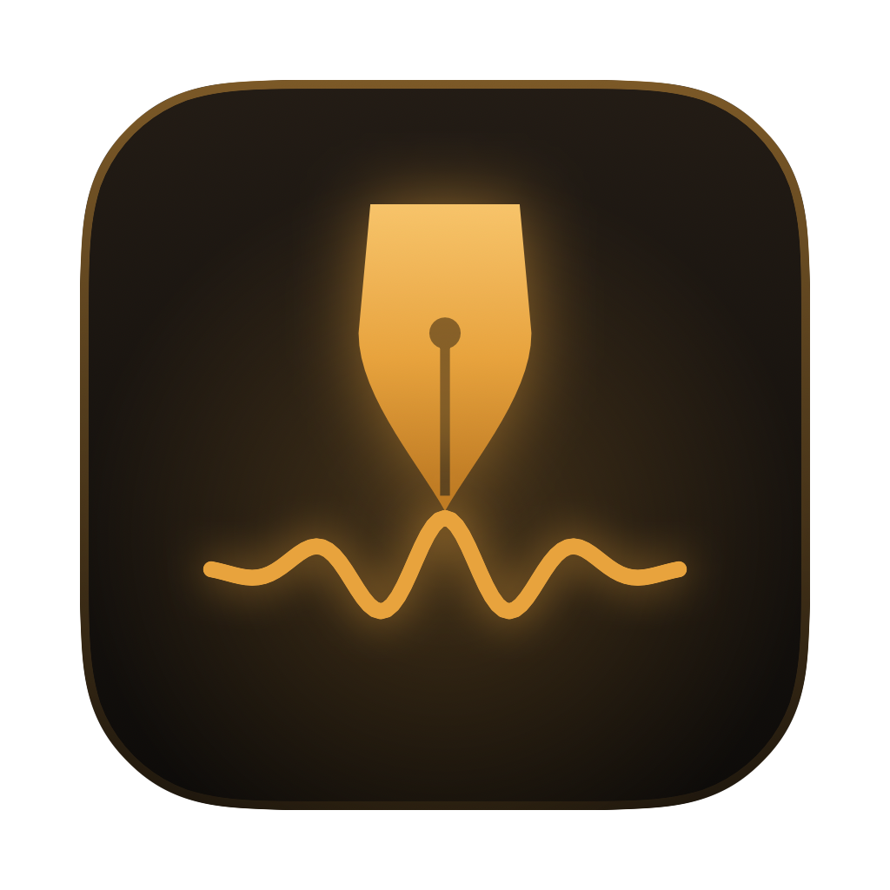

<p align="center"></p>

<h1 align="center">Quill</h1>

<p align="center">Hold a key, talk, let go — clean, formatted text appears wherever your cursor is.<br>
A native macOS dictation app. Speech recognition runs entirely on your Mac.</p>

---

## What it does

- **Hold `fn` to talk**, release to paste. **Double-tap `fn`** for hands-free; tap again to finish. `esc` cancels.
- **On-device Whisper** (WhisperKit / Core ML). Audio never leaves your Mac.
- **Formatting, not just transcription** — removes filler words, applies spoken corrections
  (“seven, no wait, eight” → “8”, “scratch that”), turns “first… second…” into numbered lists,
  “bullet point” into bullets, and follows “new line” / “new paragraph” and spoken punctuation.
- **Per-app style** — formal for email, casual for chats, exact technical terms in code editors.
- **Clean-up engines** — Apple Intelligence (on-device, default), Claude (Anthropic API),
  any OpenAI-compatible local server (Ollama, LM Studio), or plain rules. Every AI path is checked
  so it can't answer or rewrite what you said, and falls back to the rules if it tries.
- **Dictionary & snippets** — teach it names and jargon; say a cue phrase to expand saved text.
- **A small floating bar** you can drag to any screen edge; it shows a live waveform while you talk.
- **Private history** in a local SQLite database.

## Requirements

- macOS 14 or later on Apple Silicon (Apple Intelligence clean-up needs macOS 26+)
- Xcode 16 or later to build

## Build

```bash
git clone https://github.com/Loomy00/quill.git && cd quill
scripts/create_signing_identity.sh   # optional, once: stable local signature so permissions survive rebuilds
scripts/build_app.sh                 # → build/Quill.app
open build/Quill.app
```

`scripts/make_icon.sh` regenerates the app icon from `Sources/Quill/Views/Logo.swift`.
`build/Quill.app/Contents/MacOS/Quill --selftest` runs the storage and formatting tests.

## First run

1. Allow **Microphone** and **Accessibility** (Accessibility is what lets Quill hear `fn` and paste).
2. In System Settings → Keyboard, set **“Press 🌐 key to” → Do Nothing**, and don't use
   “Press 🌐 twice” as the Apple Dictation shortcut.
3. The first launch downloads the Whisper model once (~630 MB for Large v3 Turbo).

Data lives in `~/Library/Application Support/Quill/`.

## Layout

| Area | Path |
|---|---|
| App entry, menu bar, CLI test modes | `Sources/Quill/App/` |
| Recording → transcription → clean-up → paste | `App/AppState.swift` |
| Microphone capture (16 kHz mono) | `Audio/AudioRecorder.swift` |
| Whisper | `Transcription/Transcriber.swift` |
| Formatting rules, AI clean-up, faithfulness check | `Cleanup/` |
| `fn` gestures, paste, keychain | `System/` |
| SQLite history, dictionary, snippets | `Storage/Database.swift` |
| Interface, floating bar, logo | `Views/` |

## License

MIT — see [LICENSE](LICENSE). Third-party licenses in [THIRD_PARTY_NOTICES.md](THIRD_PARTY_NOTICES.md).
